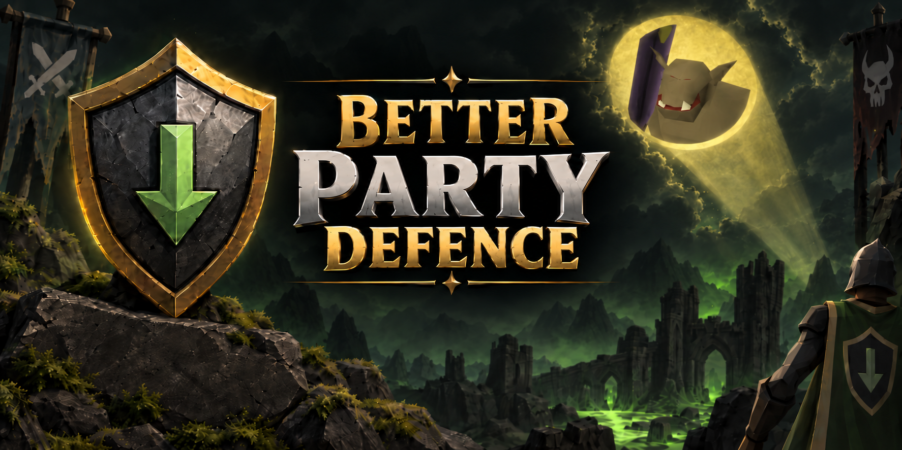

# Better Party Defence

Better Party Defence is a RuneLite plugin that estimates the current Defence of supported bosses and NPCs. It tracks your own defence-draining attacks and spells in solo play and can share encounter state with other players in the same Hub Party.

  

># Current version: **v1.4.1**
> **Seeing different Defence values?** Check that everyone in your party is running the same version of Better Party Defence. If someone has had RuneLite open since before the update, have them restart their client and check again.

  

# Suggested settings

| Plugin | &nbsp;&nbsp;&nbsp;Recommended settings |
| --- | --- |
| &nbsp; | &nbsp; |
| **Better Party Defence** | &nbsp;&nbsp;&nbsp;Start with the defaults. Customize as needed. |
| &nbsp; | &nbsp; |
| **Special Attack Counter** | &nbsp;&nbsp;&nbsp;Keep enabled. Turn off any infoboxes |
| &nbsp; | &nbsp; |
| **Party Defence Tracker** | &nbsp;&nbsp;&nbsp;Keep enabled. Turn off any infoboxes |

  

# Display

- Show estimated Defence on the NPC, in an infobox, or both. **Show defence tracker** controls the overhead display. The **Defence info box** has its own toggle.

- Customize the overhead position, font, size, skill icons, and Defence formatting. The Defence infobox uses the same colours and thresholds as the overhead display.

- Where supported, Magic Defence has its own display and infobox settings. Magic Defence readouts are currently hidden in The Fractured Archive.

- Separate infoboxes are available for weapon specs, Vulnerability, Shadow Barrage with the Shadow ancient sceptre, and the Red Keris timer in Tombs of Amascut.

  

# Party support and sync

Better Party Defence uses the same RuneLite party session as Hub Party Panel. You can join through Hub Party Panel and leave RuneLite’s built-in Party sidebar disabled. Better Party Defence detects your own supported special attacks directly, including when you play solo.

Party members running Better Party Defence can share supported Defence drains and current encounter state. Party members using RuneLite’s Special Attack Counter can also contribute supported special attacks through its standard party messages.

Shared encounter state helps when a player joins late, briefly loses sight of a target, or returns after dying. Better Party Defence checks the party and encounter before applying shared updates, keeping separate raid instances isolated.

  

# Multi-target encounters

Better Party Defence keeps separate Defence values and special attack histories for supported targets in the same encounter. For example, you can switch between Olm’s claws and return to each claw’s tracked value.

  

# Supported special attacks

- Dragon Warhammer
- Elder Maul
- Bandos Godsword
- Arclight / Darklight
- Emberlight
- Barrelchest Anchor
- Bone Dagger
- Dorgeshuun Crossbow
- Accursed Sceptre
- Tonalztics of Ralos
- Seercull
- Eye of Ayak

Better Party Defence also tracks Defence reductions from;
- Vulnerability, including the Tome of Water bonus
- Shadow Barrage with the Shadow ancient sceptre when applicable. 
- A successful Red Keris spec in Tombs of Amascut starts a party-synced damage-effect timer.

  

# Supported bosses

Better Party Defence currently supports the following bosses and encounter targets.

### Chambers of Xeric

- Abyssal Portal / Vespula Portal
- Deathly Mage
- Deathly Ranger
- Great Olm
- Great Olm Left Claw
- Great Olm Right Claw
- Ice Demon
- Lizardman Shaman
- Skeletal Mystic
- Tekton
- Vasa Nistirio

### Theatre of Blood

- The Maiden of Sugadinti
- Pestilent Bloat
- Nylocas Vasilias
- Sotetseg
- Xarpus
- Verzik Vitur

### Tombs of Amascut

- Akkha
- Akkha's Shadow
- Ba-Ba
- Core
- Elidinis' Warden
- Kephri
- Obelisk
- Tumeken's Warden
- Zebak

### The Fractured Archive

- Archive Guardian
- Ezekiel
- Bork
- The Smorks
- Moia
- Dreadnoth the Jellied
- Xarth
- Dagon'hai Elder
- Dagon'hai Monk (both monks tracked independently)
- Ocellus

### Other bosses

- Abyssal Sire
- Alchemical Hydra
- Araxxor
- Artio
- Callisto
- Calvar'ion
- Cerberus
- Chaos Elemental
- Commander Zilyana
- Corporeal Beast
- Dagannoth Prime
- Dagannoth Rex
- Dagannoth Supreme
- General Graardor
- Giant Mole
- Kalphite Queen
- King Black Dragon
- Kree'arra
- K'ril Tsutsaroth
- Nex
- Phantom Muspah
- Phosani's Nightmare
- Sarachnis
- Scorpia
- Skotizo
- Spindel
- The Hueycoatl
- The Nightmare
- TzKal-Zuk
- TzTok-Jad
- Vardorvis
- Venenatis
- Vet'ion
- Vorkath
- Yama
- Zulrah

  

# Not currently supported

Examples of bosses and encounters outside the current tracking list include the following.

- Duke Sucellus
- The Leviathan
- The Whisperer
- Scurrius
- Moons of Peril
- Royal Titans
- Chambers of Xeric Guardians
- Muttadiles
- Vanguards

  
  

# Frequently asked questions (FAQ)

  

# How do I report an issue?

Click **Report an issue** on the Plugin Hub page. Include the boss and phase, your plugin version, what you expected, and what the tracker showed. For party sync issues, include the versions your teammates were running and the Defence value each player saw, if available.

  

# Is this vibe coded?

Yes, I use AI. If you’re asking because something went wrong in-game, **what did the tracker show, and when in the encounter did it happen?** That gives me a starting point for reproducing it.

AI saves me time implementing the logic. I research how the game works, decide how the classes, methods, flags, and RuneLite events fit together, review the code, and monitor those events in developer mode while testing in-game.

I want to fix as many edge cases as I can. Calling it “vibe-coded slop” gives me nothing specific to investigate. The project is open source, and I’m happy to work with anyone who wants to report a bug or contribute a fix. AI is already part of many developers’ workflows, including mine.

  

# Is the plugin still being developed?

Yes. I read every issue on GitHub and use those reports and player feedback to track bugs and decide what to improve next.

  

# Why did you build a separate Defence tracker?

I built Better Party Defence for my friends and I after we ran into consistency issues with our setup. I never expected it to become a community plugin, but here we are. The changes we wanted for party sync and multi-target tracking were extensive enough to build a separate plugin. If your current tracker works well for you, feel free to keep using it. I made this plugin for myself, and I'm glad others get to enjoy it as well.

  

# I returned to a boss long after and it still had the same defence information?

If you teleport away before finishing the fight in the open world outside of raids, Better Party Defence can keep the last Defence value it saw. Giant Mole, for example, leaving the area is treated as losing sight of the boss, so the tracker can pick up where it left off when you return.

If the value is stale, in this example you would kill Giant Mole once while it’s visible on your client. The tracker will see the death, clear the saved value, and start fresh on the next kill.

Or simply hop worlds, this will also clear the stale value and start fresh.

  
  

# Attribution

The original above hp display, boss stat data and Defence-drain calculations were derived and ported from OSParty code supplied with the original project. Local special attack detection follows RuneLite’s Special Attack Counter event model for defence-draining weapons.
See [ATTRIBUTION.md](ATTRIBUTION.md) and [LICENSE-OSPARTY.txt](LICENSE-OSPARTY.txt) for details.

  

# Original work in Better Party Defence

- Designing Better Party Defence’s event system to record when special attacks land, tie them to the right encounter, and reconcile what different clients observed.

- Sharing Defence values and special attack history across clients in the same party and encounter.

- Tracking multiple targets independently and deciding when to keep or clear each target’s data as players leave render distance, return to a fight, or move between boss phases.

- Resolving same-tick special attacks consistently across clients and distinguishing Ralos hits from thrall damage.

- Building display options for current and previous targets, with matching colours and thresholds for the overhead display and Defence infobox.

- There’s more original work throughout the plugin. The additions listed here took the most time to design, implement, and test.
  

<h5 align="center"> If any of these solutions would help your plugin, you’re welcome to reuse my work with attribution under the project’s licence. Open source the world!🌍  </h5>

  
  

<h2 align="center">Yours truly, Heisty 🔥</h2>

  I can do countless things right, and someone will still find the one thing I got wrong.
  If they saw something I missed, I have a reason to come back tomorrow and do it better.
  To all the haters, thank you. You give me another reason to improve every day.

  
  

<h3 align="center">Coffee is always appreciated, but never expected! ☕✨</h3>

  

